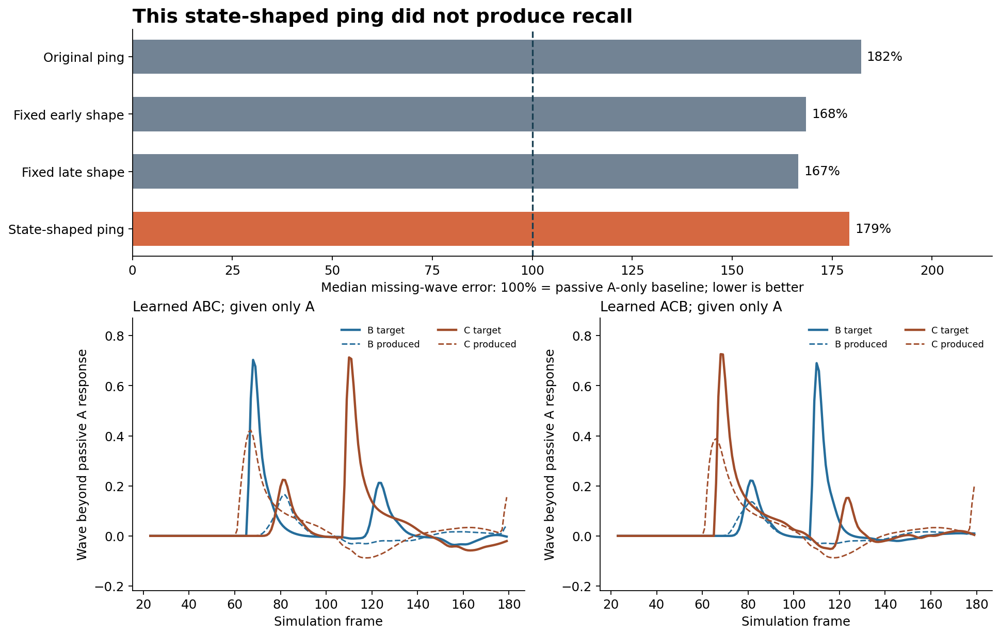

# StateShapedPingRecall

**Can a grown wave network reconstruct a missing sequence when its pings carry recent local state? In this pilot, no.** A separate supplied inverse model successfully recovered hidden source strengths, but the neurons did not learn that model.

Antti Luode's research direction · initial experiment, code and report by Astra · 15 November 2026.

[Full report](REPORT.md) · [Protocol fixed before the batch](PROTOCOL.md) · [Numerical summary](summary.json) · [All 96 bodies](results.json) · [Review and next gates](REVIEW.md)

## Follow-up: predictive damping (Gemini's proposal)

Fable tested a different learning rule on a different body: 24 fade timers with signed branches that learn to **flatten the field at their own tips** after they fire. The rule set beforehand concerned cancellation and a negative predicted wave; Astra's positive reconstruction score was reported unchanged and was expected to fail.

**Result: three of four pre-set conditions passed; the fourth failed narrowly.** On the primary task (three events, 24 bodies), a learned sequence leaves 60% of its surprise, an omitted sequence produces an anti-wave (score 0.32), and all 24 bodies prefer their own history. When the *other* order arrives, the field is 126% of an untrained body's: unexpected input stands out. But the control that swaps which timer drives which branches costs too little (paired interval −0.01 to 0.15), so the rule is not counted as producing sequence prediction. With two events the rule clearly uses timing.

A post-hoc analysis shows why: two thirds of the timers fire within ten ticks of each other, and a trained body's own anti-waves shift its slow timers, so the **second** predicted event is barely cancelled. Astra's reconstruction score stayed negative (−1.46), as declared. [Full damping results](damping/README.md) · [protocol](damping/PROTOCOL_DAMPING.md) · [review notes](REVIEW.md#predictive-damping-follow-up).

## What was tested

Three fade-triggered units share a 96×96 wave field. Each has eight candidate return branches. A local growth rule changes their weights and prunes weak branches over twenty episodes of **A→B→C** or **A→C→B**. Every episode starts with activity wiped; only branch weights and survival persist.

After training, activity is wiped again and growth is frozen. Both histories receive exactly the same **A-only cue**. The test asks whether their physical wave responses reconstruct the missing B/C sequence at eight sensors. No trained decoder, test label, scheduled B/C input, fitted gain or time shift drives recall.

Twelve independent training schedules are paired across two histories and four ping conditions: **24 bodies per condition, 96 total**. The bodies within a schedule are not independent statistical replicates.

| Ping condition | Median missing-wave error | Own history preferred |
|---|---:|---:|
| Original one-frame impulse | 182.2% | 15/24 |
| Fixed early-heavy packet | 168.4% | 14/24 |
| Fixed late-heavy packet | 166.6% | 13/24 |
| Shape selected from recent local history | 179.3% | 11/24 |

**100% is passive A-only propagation; lower is better.** Error is squared waveform error divided by target squared norm. The stored score is `1 − relative error`: zero is baseline, one is perfect, negative is worse. A small preference for the correct history is insufficient if the reconstructed wave is inaccurate. All four conditions failed the reconstruction criterion.



## What the richer ping does—and does not do

The two packets are `[0.192, 0.048]` and `[0.048, 0.192]`. They have the same impulse (0.24) and squared-drive sum (0.039168), but different timing centroids. The state condition chooses between them using the preceding 50 samples of local signed-wave history. These are toy packets, not biological action potentials.

The original impulse has equal area but **higher squared-drive sum** (0.0576). Whole-episode drive is also not matched because feedback changes firing counts. The fairest payload comparison is therefore state-shaped versus both fixed two-frame packets. Its paired seed-bootstrap intervals cross zero against both.

Controls include no growth, scrambled branch destinations, a silent cue, exact-target scoring, and payload permutation with firing times held fixed. Payload permutation actually changes only 16/24 state-shaped bodies (44 events), limiting that control. See the report for all failed controls and uncertainty.

## A separate inverse-model positive control

[inverse_control.py](inverse_control.py) supplies the wave tank's unit-source responses at three known locations and a known onset. From two noisy sensor time series it estimates three source amplitudes, then predicts six other sensors at later times. Across 32 mixtures, median relative amplitude error is **0.253%** and median held-out waveform score is **0.9999983**.

This is an engineered least-squares inverse using the same known physics as the generator. It establishes recoverability in this small setting. It does **not** establish learned inverse modeling, a biological mechanism, general scene understanding, or an advantage of shaped pings. Its score uses a different baseline and must not be compared numerically with the recall score.

## Run locally

Python 3.12 was used for the original batch. CPU only; no GPU, GUI, server, model download or upstream checkout is needed. From a clone of this repository:

```sh
python -m pip install -r requirements.txt
python verify.py
python run.py --smoke --workers 1
```

The smoke run is a two-episode plumbing check, **not scientific evidence**. For the full reproduction:

```sh
python run.py --workers 4
python inverse_control.py
python analyze.py
```

Use `--workers 1` if you prefer a smaller CPU load. Run in a disposable clone if you want to keep the checkout pristine: the scripts overwrite their matching result files and selected traces; analysis rewrites the summary and figure. The original batch took about 77 seconds on Astra's machine; runtime depends on the machine. [Reproduction notes](REPRODUCTION.md) record the repository repair and verification.

## Repository contents

| Path | Purpose |
|---|---|
| `run.py` | Frozen recall runner, four packet conditions, paired schedules and controls |
| `verify.py` | Exact original-009 impulse equivalence and per-packet matching checks |
| `inverse_control.py` | Separate supplied-physics inverse diagnostic |
| `analyze.py` | Seed-paired bootstrap summary and figure |
| `vendor/experiments/009_morphology_as_memory/core.py` | Pinned graph builder and host-order simulation |
| `vendor/nodes/`, `vendor/up/nodes/`, `vendor/tests/` | Minimal node snapshots and headless host shim |
| `damping/` | Predictive-damping follow-up: protocol, runner, results, post-hoc bounds ([README](damping/README.md)) |
| `traces/` | First scientific seed and development-seed `.npz` traces |
| `results.json`, `inverse_control.json`, `summary.json` | Original numerical receipts |
| `PROTOCOL.md`, `REPORT.md` | Original protocol and interpretation |

## Lineage and boundaries

The direct experimental parent is [PerceptionLabAI experiment 009](https://github.com/anttiluode/PerceptionLabAI/tree/54b20b90b9356d7d622695ad9072b07ce569c5f7/experiments/009_morphology_as_memory). Nodes originate in that workshop and [PerceptionLab](https://github.com/anttiluode/PerceptionLab/tree/0291f579123ce4261aade4e6c5a7b040f8177f1e). [GeometricNeuronV30](https://github.com/anttiluode/GeometricNeuronV30) explains the related fade-triggered wave line; this is not a port of the native GN27 equations. [Genealogy](https://anttiluode.github.io/Genealogy/) records the wider family.

Source pins: PerceptionLabAI `54b20b90b9356d7d622695ad9072b07ce569c5f7`; PerceptionLab `0291f579123ce4261aade4e6c5a7b040f8177f1e`. The biological preprint is motivation discussed in the report, not validation of this model.

This negative result bounds **one encoding, one local growth rule, three units and one task**. It does not rule out other learning rules or state codes. The current rule grows toward recently active sites; it has no explicit objective for predicting missing sensory consequences. Whether that is the decisive bottleneck remains a hypothesis.

MIT license; see [LICENSE](LICENSE).
