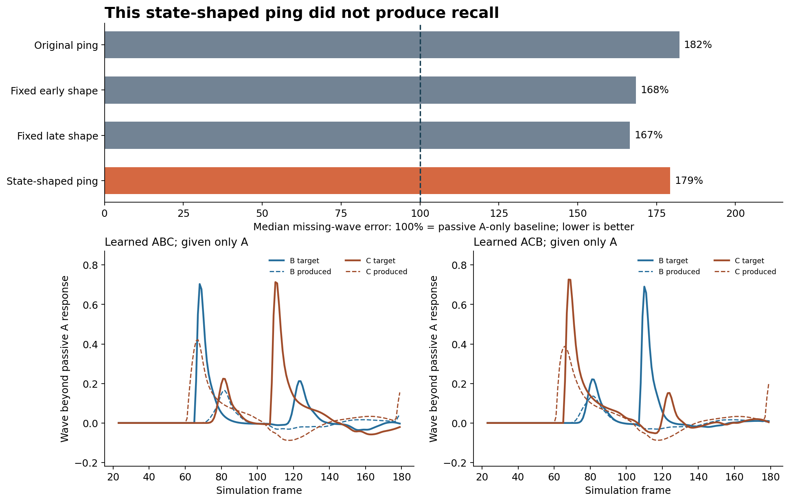

# Can state-carrying pings reconstruct a missing wave?

15 November 2026 · Antti's perception research · exploratory computational pilot

**Result: this pulse-shape upgrade did not make the existing grown network recall a missing sequence. A separate, deliberately supplied inverse model could recover hidden source amplitudes from partial wave observations. These are different tests, not competing scores.**

## The vision made testable

An outside world generates signals. A population could infer the causes of those signals, retain a distributed internal state, and use it to regenerate or predict sensory consequences. A ping could carry information about a sender's recent state. Connections could learn how those pieces constrain one another. That is a coherent computational research direction. It does not require each neuron to represent one object or word, nor does a successful simulation demonstrate subjective experience.

Three distinct claims matter: (1) history changes a ping, (2) receivers use that difference for better reconstruction, and (3) an internal model infers hidden causes and predicts new observations. The paper motivates (1). This pilot tests a small version of (2). The supplied-model diagnostic illustrates (3), without claiming the network learned it.

## Main experiment

We used the actual WaveFieldNode, FadingHistorySpikeNode and GrowingReturnNode from pinned PerceptionLab source snapshots. The wave grid remains 96×96, with three fade-triggered units and eight candidate returns per unit. The one-frame baseline reproduced the original 009 host simulation exactly in a regression check: final weights, surviving branches and spike times.

Twelve random training schedules each produced an ABC-trained and an ACB-trained body in each of four conditions: **96 trained bodies total, 24 per condition, clustered into 12 paired schedules**. Training used twenty episodes, varied stimulus strengths and timings, and wiped all fast states between episodes. Only structural weights and branch survival persisted. No hardening was introduced.

Recall began from another complete activity wipe. Both histories received the same A-only cue at a new onset and standard amplitude. Growth was frozen. No classifier, fitted decoder, scheduled B/C input, target waveform or test label drove the body.

The two shaped pulses were [.192,.048] and [.048,.192]. They have identical total impulse and identical squared-drive sum. The state condition chooses between them using local signed-wave variability over the preceding 50 samples. These are toy wave packets, not biological action-potential shapes. Their timing centroids differ by 0.6 frame. The original one-frame .24 ping has the same impulse but greater squared-drive sum. Total episode drive is not matched, because shapes can change subsequent spike counts. Growth still updates once per original firing, not once per packet sample.

The target is the missing wave: passive full-sequence response minus passive A-only response. The prediction is the grown body's A-only response minus that same passive A response. We compare signed waveforms at all eight sensors in a fixed window, without fitting gain or shifting time. This tests sensor-sampled reconstruction, not every grid pixel.

| Condition | Median error relative to passive A-only | Correct history's waveform preferred |
|---|---:|---:|
| Original identical ping | 182.2% | 15/24 |
| Fixed early-heavy packet | 168.4% | 14/24 |
| Fixed late-heavy packet | 166.6% | 13/24 |
| State-shaped packet | 179.3% | 11/24 |

**100% is the passive A-only baseline; lower is better; 0% would be perfect reconstruction.** Correct-template preference alone is insufficient: an inaccurate response can be slightly closer to one template. State-shaped recall failed both the error-reduction and history-specificity criteria. Its paired mean differences against both fixed packet controls had 95% seed-bootstrap intervals crossing zero. With only twelve independent schedules these intervals are wide; see summary.json.

Controls did not rescue the claim. State-shaped median reconstruction scores (1 − relative error) were −0.793 after growth, −1.026 without growth, −0.785 after scrambling branch destinations and −0.750 after shuffling payload shapes while keeping spike onsets fixed. The latter permutation actually changed shapes in 16/24 bodies, across 44 events; eight bodies had no effective change, so it is a limited payload-specific test. Training used both shapes, rather than collapsing into one constant payload: 2,276 of 4,473 state-condition firings selected the late-heavy shape. No training or primary-probe frames clipped. No-cue controls stayed exactly silent. Exact-target injection into the scoring calculation scored 1.0. Same-payload replay reproduced closed-loop probe waveforms exactly.



The plotted examples are the first seed chosen in advance, not the best or worst bodies. Their responses miss the expected second event. Different bodies' primary numerical results are all preserved in results.json.

## Separate diagnostic: what an actual inverse model looks like

This was added after observing the negative recall result and is explicitly a different task. We supplied the model with the wave tank's known responses to unit pulses at three known source locations (0,4,7), with known onset and known medium. In 32 fresh mixtures, each source's amplitude was independently sampled from .5 to 1.5. The model observed only sensors 1 and 6 during frames 24–49, with Gaussian noise at 1% of observation RMS. Least squares inferred the three amplitudes. It then predicted six different sensors during frames 50–139, which were never used for inference.

Median relative source-amplitude error was **0.253%**. Median held-out waveform score was **0.9999983** relative to zero prediction. The very high accuracy is expected in this easy, well-specified linear setting: generator and inverse dictionary use the same forward physics; location, onset and dynamics are known; only three amplitudes are unknown. This is not biological learning, novel AI, or evidence that grown branches acquired an inverse model. It is a positive control demonstrating recoverable hidden variables in the medium and a concrete definition of success.

The inverse step is sensors → inferred source amplitudes. The forward generative step is inferred source amplitudes → predicted waves at unseen sensors and times. Completing ABC from A is instead associative prediction. Both are computations, but they answer different questions. Cancelling a wave in antiphase by itself does not establish inference about its hidden cause.

## What this contributes to the image

The useful distinction is between **a record of what happened** and **a model that can use the record to predict what was not observed**. Earlier structural-memory experiments addressed the former. This pilot asks for the latter and does not find it.

Inspection of the existing growth rule suggests a plausible bottleneck, not a demonstrated cause: branches grow toward recently active sites when their unit fires. There is no rule teaching a branch which future sensory consequence it should reproduce or which residual error it should reduce. Giving a message a richer alphabet does not automatically supply that mapping.

The next justified test would connect learned internal state to a held-out prediction objective, then compare fixed and shaped pings under the same learning rule. A stronger inverse-model gate would vary hidden source location, strength and onset, infer them from partial observations, and predict other sensors after a source is moved or removed. Keep an ordinary linear/system-identification baseline. Only after learning works should pulse-shape ablations be used to claim an advantage of state-carrying messages. Nothing here establishes that shaped spikes are necessary: timing and population patterns can carry information with fixed-shape spikes too.

## Paper check

The supplied Martin-Burgos et al. preprint, *Action potential waveforms are state-dependent*, reports waveform features predicting recent-input statistics. The R² values .72/.35/.62 quoted in the conversation are specifically for Cell 1; the second cell's effects were weaker (PDF page 5). The discussion describes heterogeneous, modest LFP relationships and cites earlier studies in which presynaptic spike width affects postsynaptic currents (PDF pages 7–8). That is motivation for a richer communication channel, not a demonstration in this paper of receiving neurons decoding a scene or reconstructing a world. It is a preprint, not a proof of the larger theory.

## Reproduce

Python 3.12 was used. Install requirements.txt, then run:

```sh
python verify.py
python run.py --workers 4
python inverse_control.py
python analyze.py
```

The scientific batch took about 77 seconds in this environment; speed will vary. No GPU or server is needed. `run.py --smoke` is a short plumbing check only. PROTOCOL.md was written before the scientific batch. Results include protocol and runner SHA-256 hashes. All seeds, per-body structures, events, raw scores and selected traces are retained. The vendored files are a minimal source snapshot, not an entire checkout. Their MIT license is included. This package is a headless exploratory assay, not a host-loadable new GUI node or a published numbered PerceptionLab experiment.

Source pins:

- PerceptionLabAI: 54b20b90b9356d7d622695ad9072b07ce569c5f7
- PerceptionLab: 0291f579123ce4261aade4e6c5a7b040f8177f1e
- Biological source: supplied PDF, doi:10.64898/2026.09.15.751814, version posted 21 September 2026.

No changes were pushed to either repository. This result is a bounded negative for one shape code, one local growth rule, three units and this task; it does not rule out other encodings, learning rules, recurrent architectures or the broader vision.
