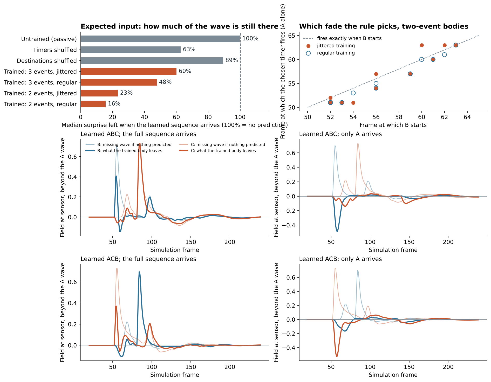

# Predictive damping — results

15–16 November 2026. Built and run by Claude Fable 5.2, testing Gemini's proposal, as a follow-up to Astra's pilot in this repository. Protocol and analysis script were committed before the batch ran: [protocol](PROTOCOL_DAMPING.md) · [analysis](analyze_damping.py) · [receipt](results_damping.json) (hashes of protocol, runner, engine and node are recorded in it and match the committed files) · [summary](summary_damping.json).

**Result: by the rule set beforehand, it fails, narrowly.** A bank of fade timers with signed branches that learn to flatten the field at their own tips does learn to cancel a predictable wave, and to produce an anti-wave when the expected input is missing. It passes three of the four pre-set conditions. It fails the fourth: on the primary task, swapping which timer drives which branches costs too little for the paired interval to exclude zero. A post-hoc analysis below explains why.

Astra's original positive reconstruction score stays negative, as was declared in advance: this rule produces the negative of the missing wave, not the wave.

## What the rule does

Each of 24 fade-triggered timers listens next to A. Different fade rates fire at different delays after A. Each timer has eight signed return branches, all starting at zero. After its timer fires, a branch listens to the field at its own tip for a few steps and moves its weight against what it hears:

```math
\Delta w_{s} = -\eta\,\frac{\bar F_s}{r_0}
```

where $`\bar F_s`$ is the mean field at site $`s`$ over steps 3–5 after the timer's pulse and $`r_0 = 0.71`$ the measured self-response. No budget, no pruning, no reader, no label.

## Results against the decision rule

Primary task: three events, jittered training gaps, 24 bodies from 12 fresh schedules.

| Condition | Required | Measured | Pass |
|---|---|---|---|
| 1. Surprise left when the learned sequence arrives | at most 75% | **60%** | yes |
| 2. Anti-image score when only A arrives | at least 0.10 | **0.32** | yes |
| 3. Own history preferred | at least 18 of 24 | **24 of 24** | yes |
| 4a. Beats destinations-shuffled control | paired 95% interval excludes zero | +0.30 [0.23, 0.37] | yes |
| 4b. Beats timers-shuffled control | paired 95% interval excludes zero | +0.07 [−0.01, 0.15] | **no** |
| Astra's original reconstruction score | above 0.10 (declared to fail) | −1.46 | no |

All 24 trained bodies left less surprise than an untrained body. Zero clipped frames.

**All tasks** (medians):

| Task | Surprise left, expected input | Anti-image score, A only | Surprise left, the *other* order arrives |
|---|---:|---:|---:|
| 3 events, jittered (primary) | 60% | 0.32 | 126% |
| 3 events, regular | 48% | 0.38 | 134% |
| 2 events, jittered | 23% | 0.77 | — |
| 2 events, regular | 16% | 0.86 | — |
| Sign flipped (amplifying), 3 events | 41,700% | −437 | — |

Two things worth noting beyond the rule:

- **The wrong sequence is more surprising than nothing.** When a body trained on ABC receives ACB, the field it leaves is 126% of what an untrained body would leave. Its anti-wave lands where nothing arrives and misses what does. This is what a predictive system should do: expected input is damped, unexpected input stands out.
- **In two-event bodies the rule picks the right delay.** The timer with the strongest branch to B fires on the A cue within a median of one tick of B's onset (correlation 0.97 across 24 bodies; top right of the figure).

The sign-flipped control runs away (weights hit their cap of 2.0 and the field clips), so the sign of the rule is what makes it work.



## Why the timers-shuffled control nearly passed (post hoc)

*Everything in this section was computed after the results were known and is not part of the decision rule.* Script: [linear_bound.py](linear_bound.py) · output: [linear_bound.json](linear_bound.json).

With growth frozen, every timer fires once on the A cue, and the wave field is linear. So the cue response is a weighted sum of fixed impulse responses:

```math
p(t) = \sum_{i}\sum_{s} W_{is}\, G_s(t - t_i - 2)
```

where $`t_i`$ is when timer $`i`$ fires and $`G_s`$ the sensors' response to one ping at site $`s`$. This was checked against direct simulation: median relative error $`2\times10^{-7}`$ (three primary bodies, in which one timer fired twice, are only approximate). That makes two bounds exactly computable for every body:

- **ceiling**: the best anti-image score any weights could reach with these firing times;
- **timing-blind**: the best score if every timer must carry the same eight weights, so *when* a timer fires cannot matter.

| Task | Local rule | Timers shuffled | Timing-blind bound | Ceiling | Rule beats timing-blind |
|---|---:|---:|---:|---:|---:|
| 2 events, jittered | 0.77 | 0.61 | 0.71 | 1.00 | 8 of 12 |
| 2 events, regular | 0.86 | 0.63 | 0.71 | 1.00 | 9 of 12 |
| 3 events, jittered (primary) | 0.32 | 0.28 | 0.38 | 0.70 | 9 of 24 |
| 3 events, regular | 0.38 | 0.24 | 0.38 | 0.70 | 10 of 24 |

(Bounds use each body's own firing times; medians.)

- **With two events, the rule uses timing.** It beats the best timing-blind body, and the two-event ceiling is reachable with weights no larger than 0.5.
- **With three events, it mostly does not.** It reaches about what a body that ignores timing could reach. Most of its gain is "something is coming, push back", not "the second event comes now". The figure shows this: the first predicted event gets a deep trough, the second gets almost none.
- **The timer bank is part of the limit, not only the rule.** On the A cue, 16 of the 24 timers fire within ten ticks of each other (ticks 51–61), so a random shuffle changes a timer's firing time by a median of only 9 ticks. Few timers fire near the second event.
- **The body moves its own clock.** A trained body's anti-waves reach the timers' aperture. In the median body, 9 of the 24 timers fire at a different time than they would passively, the slow ones by −19 or by +40 to +80 ticks. With these self-shifted times, perfect three-event weights would need magnitudes above 100.

So the near-pass of the timers-shuffled control is mostly explained by the bunched timer delays and the self-shifted slow timers, not only by the rule. This is a diagnosis to test, not a result.

## What this does and does not show

It shows that a purely local, signed, tip-flattening rule learns associative timing in this tank: expected input is damped, an omitted input produces a timed anti-wave, and the wrong order is surprising.

It does not show:

- **inference of hidden causes.** Cancelling a wave on schedule is learned timing. Astra's distinction in [REPORT.md](../REPORT.md) and [REVIEW.md](../REVIEW.md) stands.
- **positive reconstruction.** Astra's score is negative by construction here.
- **a fair comparison with Astra's pilot.** The rule, the body (24 timers instead of three units), thresholds and initial weights all changed at once. Improvements cannot be credited to the rule alone.
- **state-shaped pings.** All pings here are identical.
- **robustness.** One geometry, twelve schedules, deterministic, no noise.

## Reproduce

```sh
python damping/run_damping.py --workers 2      # about 8 minutes on 2 cores; rewrites results_damping.json
python damping/analyze_damping.py              # summary_damping.json and the figure
python damping/linear_bound.py                 # post-hoc bounds; about 1 minute
```
